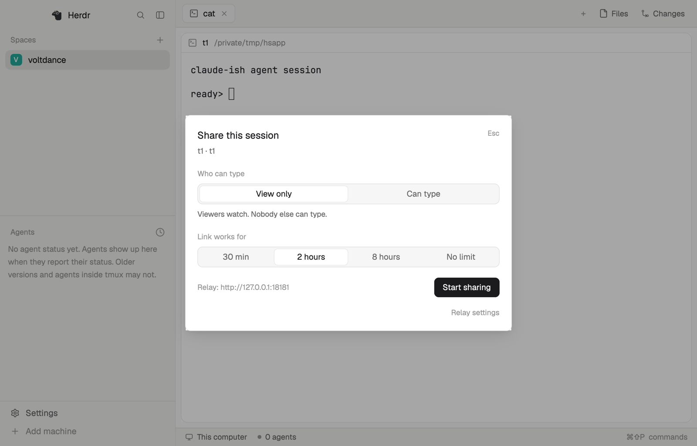
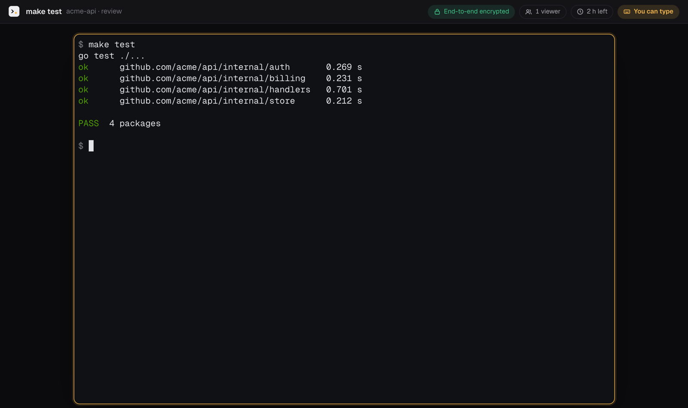

# herdr-share

Share a running [Herdr](https://herdr.dev) terminal session — an agent at work, a shell — with
someone else, live, through a relay you run yourself. They open a link in their browser. Whether
they may type is decided when you share and can be changed at any time; stopping the share cuts
them off at once and the link never works again. Your session keeps running either way.

[中文说明](README.zh-CN.md)

- **One link, no accounts.** Viewers need nothing but a browser.
- **You decide who types.** View only by default; switch to “can type” and back while they watch.
- **Self-hosted relay.** One small container (`ghcr.io/jtsang4/herdr-share-relay`), works on private
  networks and air-gapped setups; the relay address is a setting.
- **End-to-end encrypted.** The key lives in the link's `#fragment`, which browsers never send to
  servers. The relay forwards ciphertext it cannot read, alter or replay.
- **Never resizes your view.** Viewers see your terminal at your size; their typing does not
  change it.

| In Herdr: the Share dialog (⌘⇧S) | In the viewer's browser |
|---|---|
|  |  |

## Get started

**1. Run a relay** (once, for you or your team):

```sh
docker run -d --name herdr-share-relay -p 8080:8080 ghcr.io/jtsang4/herdr-share-relay:latest
```

That's enough on a private network. On the internet, put it behind HTTPS and add a token
(`-e HERDR_SHARE_TOKENS=…`); see [docs/deploy.md](docs/deploy.md).

**2. Ask your coding agent in Herdr** — nothing to install:

> Use `npx skills use jtsang4/herdr-share --skill herdr-share` to share this session. Viewers can
> type, for 24 hours. Relay: http://your-relay:8080

The agent shares its own session and replies with the link; send it to whoever should watch. Mention
the relay only the first time — it is remembered. To end it, say “stop sharing”: viewers are
disconnected and the link never works again. Leave out “viewers can type” for a view-only share.

## Other ways to share

- **A shortcut in Herdr.** `npx -y herdr-share@latest mod install` adds a Share dialog to Herdr,
  opened with **⌘⇧S** (Ctrl+Shift+S on Linux/Windows) on the focused terminal.
- **The command line.** `npx --prefer-offline -y herdr-share start t7 --mode control --ttl 24h`
  (`t7` is the terminal, see `hc ls`), then `… stop t7`.

Every command, updating and uninstalling: [docs/usage.md](docs/usage.md).

## How it works

```
 your machine                                   your relay                 viewer
┌────────────────────────────────┐
│ Herdr ── Share dialog (mod)    │
│            │ herdr-share CLI   │
│            ▼                   │  outbound WSS  ┌──────────────┐   WSS   ┌──────────┐
│ bridge (background hc terminal)├───────────────▶│ herdr-share- │◀────────│ browser  │
│            │ terminal.attach   │                │ relay        │         │ (xterm)  │
│            ▼                   │                └──────────────┘         └──────────┘
│ herdr-core: your session t7    │
└────────────────────────────────┘
```

The bridge only makes outbound connections, so your machine needs no open port. Details:
[docs/architecture.md](docs/architecture.md).

## Requirements

- Sharing: [herdr-core](https://herdr.dev) (`hc`) 0.1.21 or later; the Herdr app for the dialog.
- Relay: Docker, or the `herdr-share-relay` binary from the releases.
- Viewing: a current browser. Plain `http://` works on private networks too.

## Security

Anyone with a link in **can type** mode can run commands in that terminal as you — agents can run
shell commands too. Share such links only with people you trust, keep lifetimes short, and protect
your relay with tokens. Read [docs/security.md](docs/security.md) and [SECURITY.md](SECURITY.md).

## Development

```sh
make web build      # guest client, then ./bin/herdr-share and ./bin/herdr-share-relay
make test lint      # unit tests and linters
make e2e            # isolated end-to-end run: herdr-core session, relay, CLI, real browser
```

See [CONTRIBUTING.md](CONTRIBUTING.md) and [AGENTS.md](AGENTS.md).

## License

[MIT](LICENSE)
