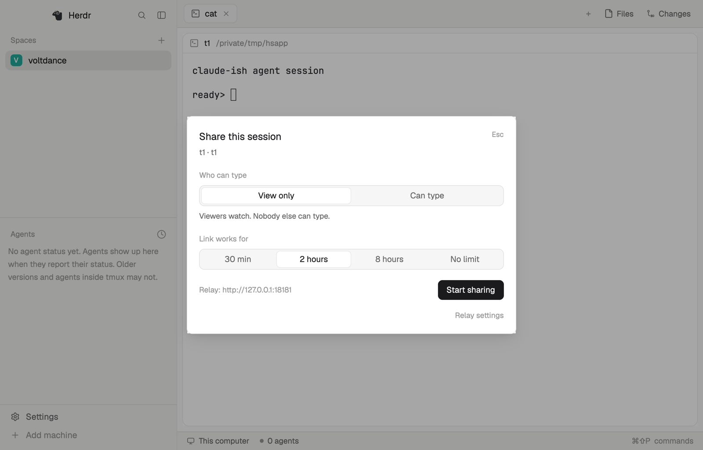

# herdr-share

把 [Herdr](https://herdr.dev) 里正在运行的终端会话（工作中的 agent、shell）实时分享给别人，经由你自己部署的中继服务。对方用浏览器打开链接就能看。能不能操作在分享时决定，分享过程中随时可以改；停止分享后对方立刻断开，链接永久失效，你的会话照常运行。

[English](README.md)

- **一个链接，不用注册**：对方只需要浏览器。
- **你决定谁能操作**：默认只读，随时切到“可操作”再切回来。
- **中继自己部署**：一个很小的容器（`ghcr.io/jtsang4/herdr-share-relay`），内网、隔离网络都能用；中继地址是可配置项。
- **端到端加密**：密钥只在链接的 `#` 片段里，浏览器从不把它发给服务器。中继只转发它读不了、改不了、也无法重放的密文。
- **不改变你的终端尺寸**：对方看到的是你的终端尺寸，对方打字也不会改变它。

## 开始使用

**1. 启动一个中继**（一次即可，个人或团队共用）：

```sh
docker run -d --name herdr-share-relay -p 8080:8080 ghcr.io/jtsang4/herdr-share-relay:latest
```

内网用这样就够了。放到公网时，请加上 HTTPS 和 token（`-e HERDR_SHARE_TOKENS=…`），见 [docs/deploy.md](docs/deploy.md)。

**2. 在 Herdr 里对 coding agent 说一句话**，什么都不用装：

> 用 `npx skills use jtsang4/herdr-share --skill herdr-share` 分享这个会话，对方可以操作，有效期 24 小时。中继地址是 http://your-relay:8080

agent 会把它所在的会话分享出去，并回复链接，发给对方就行。中继地址只需第一次说，之后会记住。不想分享了就说“停止分享”，对方立刻断开，链接永久失效。去掉“对方可以操作”就是只读分享。



## 其他分享方式

- **Herdr 里的快捷键**：`npx -y herdr-share@latest mod install` 会在 Herdr 里加一个分享对话框，在聚焦的终端上按 **⌘⇧S**（Linux/Windows 为 Ctrl+Shift+S）打开。
- **命令行**：`npx --prefer-offline -y herdr-share start t7 --mode control --ttl 24h`（`t7` 是终端地址，见 `hc ls`），用 `… stop t7` 停止。

全部命令、更新和卸载方法见 [docs/usage.md](docs/usage.md)。

## 安全

“可操作”模式下，拿到链接的人就能以你的身份在这个终端里执行命令（agent 也能执行 shell 命令）。这类链接只发给信任的人，有效期尽量短，并用 token 保护你的中继。详见 [docs/security.md](docs/security.md)。

## 开发

```sh
make web build      # 先构建访客网页，再构建 ./bin/herdr-share 和 ./bin/herdr-share-relay
make test lint      # 单元测试与静态检查
make e2e            # 隔离环境端到端：独立 herdr-core 会话、中继、CLI、真实浏览器
```

## 许可证

[MIT](LICENSE)
