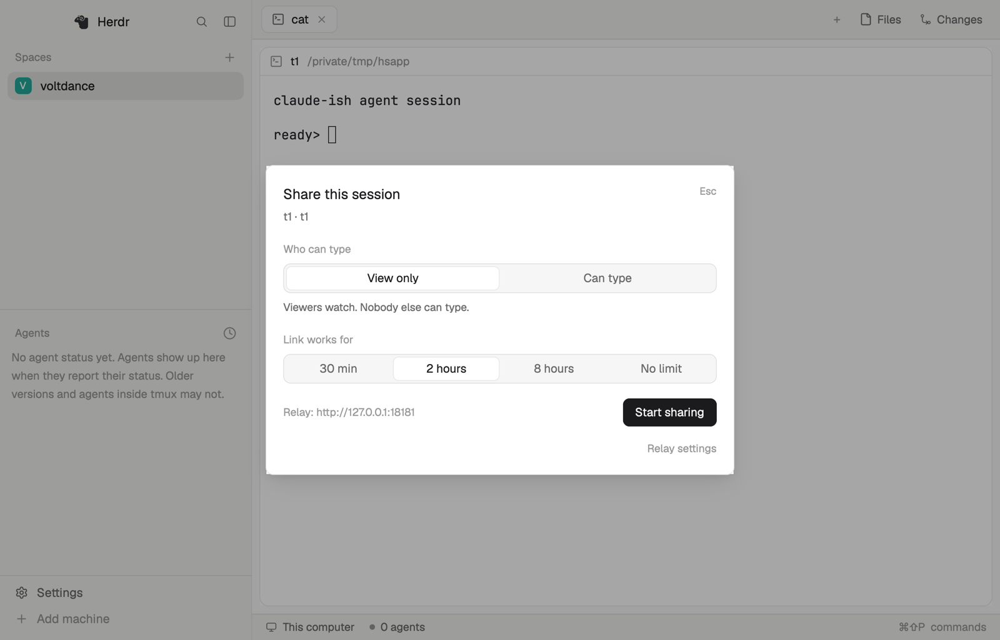

# herdr-share

Share the focused terminal (an agent at work, a shell) with someone else, live, through a relay you
run yourself. Press ⌘⇧S on a terminal: a dialog lets you choose whether viewers may type and how
long the link works, then copies a link they open in any browser. Pressed again on a shared
terminal, it shows who is watching and lets you switch typing on or off, extend the link or stop
sharing. Traffic is end-to-end encrypted; the relay cannot read it. Nothing else is added to the
window.

## What you see

A dialog, 500px wide (`mod.json` overlay `dialog`), `popover` background, 18px padding, 14px gaps,
13px text. One of four bodies, plus an error box and a footer:

- **Header** (every body): a 15px semibold title, under it a 12px `muted` subtitle — the program
  and where it lives (`claude · voltdance`, `zsh · api · review`); an 11px `dim` `Esc` on the right.
- **Relay** (first run, or *Relay settings*): title `Relay`, subtitle *Where shared sessions are
  relayed…*. Two fields, each an 11.5px `dim` label over a 34px input (8px radius, `input` border,
  `background` fill, 12.8px): **Relay address** (placeholder `https://share.example.com`) and
  **Token** (masked; hint *Leave empty if your relay is open.* or *A token is saved…*). Buttons on
  the right: `Cancel` (only when a relay is already set) and `Save`.
- **Share this session** (a terminal that is not shared):
  - **Who can type**: a segmented control (2px padding and gaps, 8px radius, `raised` fill,
    `border`), two 26px segments `View only` / `Can type`; the chosen one has the `background` fill,
    a `border` border and medium weight. Under it a 11.5px `muted` hint: *Viewers watch. Nobody else
    can type.* or *Anyone with the link can type into this terminal as you.*
  - **Link works for**: the same control with `30 min` / `2 hours` / `8 hours` / `No limit`.
  - With *Can type* chosen, a warning box (10px padding, 8px radius, `raised` fill, `blocked`
    border, 12px): *Viewers will be able to run commands in this terminal as you…*
  - A row: 11.5px `dim` `Relay: <address>` (truncated) and the primary button **Start sharing**.
- **Sharing this session** (a shared terminal):
  - The link in a 32px box (8px radius, `input` border, `background` fill, 12px `muted`, truncated)
    and a **Copy link** button.
  - **Who can type**: the same segmented control, live.
  - A row: `Ends in 1 h 58 min` (or `No time limit`) and two ghost buttons, `+30 min` and
    `2 hours from now`.
  - **Watching now (2)** (or *Nobody is watching yet*), then one row per viewer: a 6px `working`
    dot, the name, and `browser` in `dim`.
  - `Reconnecting to the relay…` in `blocked` while the relay link is down.
  - **Stop sharing**: a button with `blocked` text on `raised`, right-aligned.
- **No terminal focused**: *Focus a terminal, then open this again to share it.*
- **Error box** (any body): 10px padding, 8px radius, `raised` fill, `blocked` border and text.
- **Footer**: *Other shared sessions (n)* above a `border` line, one 12.5px row per other share
  (`title · can type|view only · n watching`) with a ghost `Stop`; and a right-aligned 11.5px `dim`
  link **Relay settings**.

Buttons are 30px tall, 7px radius, 12.5px medium; primary is `solid` / `solid_foreground`. While a
command runs, buttons dim to half opacity and the one running reads `Working…`.

## How it behaves

- **⌘⇧S** (`mod.open:herdr-share`) opens the dialog for the focused terminal; again, or Esc,
  closes it. Closing it changes nothing: shares run in the background.
- **Start sharing** runs `herdr-share start <terminal> --mode <view|control> --ttl <30m|2h|8h|0>
  --label "<space · tab>" --copy`, then posts a `success` toast *Share link copied* with the link.
- **Who can type** on a live share switches at once for everyone watching (`herdr-share mode`).
  **+30 min** adds to the current expiry; **2 hours from now** resets it (`herdr-share extend`).
- **Copy link** copies again (toast). **Stop sharing** ends the share: viewers are disconnected and
  the link never works again (toast *Sharing stopped*). The terminal keeps running.
- The dialog refreshes every 2.5s while open, so viewers appear and leave live.
- **Save** in Relay stores the address (and token) with `herdr-share config set`, then checks the
  relay with `herdr-share doctor`; an unreachable or wrong relay shows in the error box.
- Defaults (view only, 2 hours) come from `herdr-share config` (`mode`, `ttl`).
- Viewers see the terminal at the sharer's exact size; their typing never resizes it. A share ends
  by itself when it expires, when the terminal ends, or when its relay goes away.

## Built from

- One mod, `mods/herdr-share/` (`main.js`, `mod.json` with `"place": "none"` and a 500px dialog
  overlay), and `keys.json` binding `cmd-shift-s` to `mod.open:herdr-share` in `global`.
- `herdr` functions: `exec`, `readTextFile`, `appHome`, `focused`, `panes`, `spaces`, `theme`,
  `props`, `closeOverlay`, `notify`, `checking`. gpui-base `InputState` / `Input` (the token input
  uses `set_masked(true)`).
- It runs the **herdr-share CLI** for everything (`--json` output): from `install.json` beside it
  when `herdr-share mod install` put it there (the exact command for that install), else
  `npx --prefer-offline -y herdr-share`. The CLI starts each share's bridge as a background
  herdr-core terminal and connects it outbound to the relay.
- The relay is a separate service: `ghcr.io/jtsang4/herdr-share-relay` (deploy notes:
  https://github.com/jtsang4/herdr-share/blob/main/docs/deploy.md).

## Watch out

- The mod **reaches the network and runs programs**: `exec` of `npx` / `herdr-share` (which
  downloads the herdr-share package and its checksum-verified binary on first use) and, through
  it, an outbound connection to the relay you configure. It reads only its own folder.
- It needs Node.js 22+ (`npx`) on the PATH Herdr's `exec` sees, unless installed with
  `herdr-share mod install` (which records an absolute command), and a relay to share through.
- `keys.json` binds `cmd-shift-s`; on Linux and Windows use `ctrl-shift-s`. Do not take a key the
  person already uses.
- *Can type* lets anyone with the link run commands as the person. Keep it opt-in, as the dialog
  does.
- `herdr-app check` writes `gpui-kit.d.ts` / `jsconfig.json` into the folder it checks; check an
  installed copy, not this one.

## Done when

- `herdr-app check mods/herdr-share` passes on the installed copy.
- With no relay configured, ⌘⇧S on a terminal shows **Relay**; after **Save** with a reachable
  relay it shows **Share this session**, with `View only` and `2 hours` chosen.
- **Start sharing** posts *Share link copied*, and the link opened in a browser shows the
  terminal's output live; in *Can type*, what the viewer types appears in the terminal.
- With the dialog open, a viewer joining shows up under **Watching now** within 3 seconds.
- **Stop sharing** returns the dialog to **Share this session**, and the open link reports
  *Sharing has ended*.
